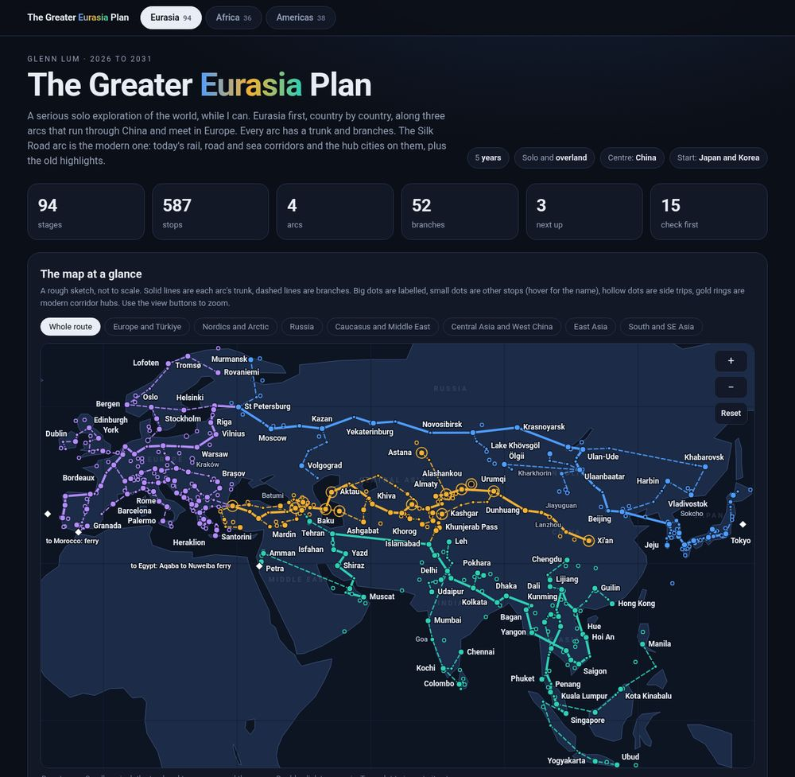
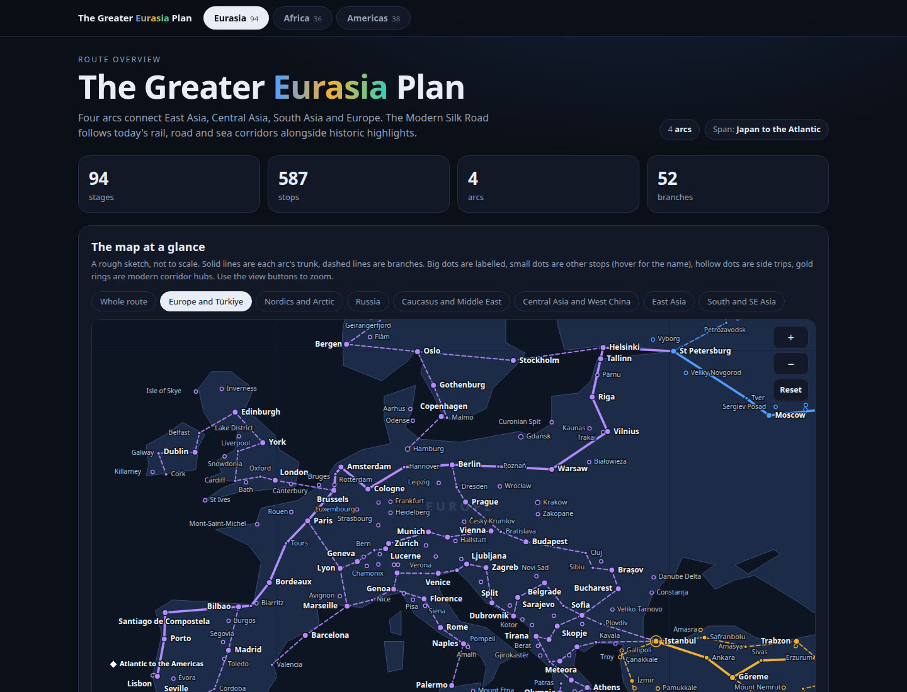

# The Greater Eurasia Plan: travel dashboard

A single-page route dashboard for exploring Eurasia, Africa, the Americas, and Oceania and the Pacific. It shows each region as a set of
**arcs** (a trunk plus named branches), every stop as a dot on an inline SVG sketch map you can pan and zoom,
and every stage as a searchable, filterable card.

It is plain HTML, CSS and JavaScript with **no dependencies and no network access**. There are two equivalent ways to open it:

- `index.html` loads the modular source from `src/`. This is what GitHub Pages serves, and it also opens straight from disk.
- `greater-eurasia-plan.html` is the same site bundled into ONE self-contained file (a small Node script makes it). Use it to email, AirDrop or archive the dashboard.



## Contents

- [File structure](#file-structure)
- [Run it locally](#run-it-locally)
- [Pan and zoom](#pan-and-zoom)
- [Rebuild the single-file version](#rebuild-the-single-file-version)
- [Publish on GitHub Pages](#publish-on-github-pages)
- [Data schema](#data-schema)
- [How to edit the content](#how-to-edit-the-content)
- [How the code fits together](#how-the-code-fits-together)
- [How this was made](#how-this-was-made)
- [Known limitations](#known-limitations)

## File structure

```
index.html                    the site: page shell plus the ordered list of CSS and script files
greater-eurasia-plan.html     BUILT single-file copy of the site. Do not edit by hand
favicon.svg                   small SVG tab icon (inlined into the built file)
.nojekyll                     tells GitHub Pages to serve the files as they are
README.md                     this file
src/
  styles.css                  all styling, one dark theme
  js/
    shared.js                 the global GEP namespace, the documented data schema, small helpers
    model.js                  parses stops, builds paths and lookups, validates the data (no DOM)
    map.js                    camera and projection, and the SVG renderer: land, routes, dots, labels
    panzoom.js                pan and zoom gestures, +/-/Reset/Move-map controls, zoom limits
    views.js                  renders nav, hero, stats, arc cards, filters, stage cards, shared cards
    main.js                   UI state, hash routing (#eurasia, #africa, #americas, #oceania), click and search handlers
  data/                       everything you edit to change the content
    meta.js                   "Last updated" text
    tabs.js                   the four pages: title text, chips, preset zoom views, map region names
    arcs.js                   the 15 arcs: code, name, colour, route summary
    branches.js               the named branches of each arc
    entries.js                white diamonds: where one page hands over to another
    land.js                   hand-drawn coarse land and water outlines for the map, including Australia, New Zealand, New Guinea and the Pacific islands
    stages/
      upper.js                Eurasia: the upper arc (Japan, Korea, Taiwan, China, Mongolia, Russia)
      silk.js                 Eurasia: the Modern Silk Road arc (Xi'an to Istanbul, Karakoram link)
      lower.js                Eurasia: the lower arc (Southeast Asia, India, the Gulf, the Levant)
      europe.js               Eurasia: Europe, from the Baltics and Poland to Lisbon, with Iceland, Greece and Türkiye
      africa.js               Africa: four arcs (north, east, south, west), including the Sahel, the Horn and the islands
      americas.js             Americas: North, Central and South America, with the Caribbean
      oceania.js              Oceania: eastern Indonesia and New Guinea, Australia, New Zealand, the Pacific
tools/
  build.js                    bundles index.html and src/ into greater-eurasia-plan.html
  check-data.js               validates the data in Node, checks country coverage, prints counts
docs/previews/                screenshots used in this README
```

## Run it locally

No install step. Pick one:

- **Double-click `index.html`** (or `greater-eurasia-plan.html`). Classic `<script>` tags are used on purpose, because ES modules do not load from `file://`.
- **Serve the folder** (closest to what GitHub Pages does): `python3 -m http.server 8000` in the project folder, then open `http://localhost:8000/`.

After editing a file under `src/`, refresh the browser. Edits do not need a build; only `greater-eurasia-plan.html` needs rebuilding.

Links to a page and zoom preset: `#eurasia`, `#africa`, `#americas`, `#oceania`, or `#africa/2` for the third preset of that page. `#oceania/5` opens the Polynesia preset.

## Pan and zoom

The map is not a fixed picture: you can move around it freely, and the preset buttons are just shortcuts to saved camera positions.



**Desktop (mouse and trackpad)**
- Drag to pan.
- Scroll the wheel, or pinch on a trackpad, to zoom around the cursor. Scrolling over the map zooms the map, so scroll the page from outside it or with the scrollbar.
- Double-click empty map to zoom in.
- `+` and `-` buttons zoom, **Reset** returns to the page's whole view. With the map focused (Tab to it), arrow keys pan and `+`, `-`, `0` zoom and reset.
- A drag never counts as a click, so clicking a dot still jumps to its stage card.

**Phone and tablet (touch)**
- The map fits the screen width, with no sideways scrolling, and **the page scrolls normally with a finger over the map**. That means it never traps your scrolling.
- To move the map, tap it (on empty map, not on a dot) or tap **Move map**. The map gets a blue outline. While it is active, one finger pans and two fingers pinch.
- Tap **Done**, or touch anywhere outside the map, to hand scrolling back to the page.
- `+`, `-` and Reset always work, active or not. Tapping a dot always jumps to its stage card.

**Behaviour that applies everywhere**
- Zoom is limited to 0.85 times the default view out and 16 times in, and the centre cannot leave the region by much.
- Dots, lines and fonts keep a constant readable size at every zoom. While you drag or pinch, the current picture is moved with a CSS transform for instant feedback. When you stop (after about 140 ms for the wheel), the map is re-rendered at the new scale, which also reveals more labels as you zoom in.
- Choosing a preset button or an arc/branch chip moves the same camera, so presets and free movement never disagree. After free movement no preset is highlighted.

The code is in `src/js/panzoom.js` (gestures and controls) and `src/js/map.js` (camera and rendering).

## Rebuild the single-file version

Needs Node 14 or newer, nothing else.

```bash
node tools/check-data.js   # optional: catches typos, and any country with no stop
node tools/build.js        # writes greater-eurasia-plan.html
node tools/build.js out/my-copy.html   # or choose another output path
```

The build replaces every `<link rel="stylesheet">`, `<script src>` and the SVG favicon in `index.html` with the file's content inlined, in
the same order. **To add a new JS file, add its `<script>` tag to `index.html`.** The build and the data check both read that list.
Rebuild after any change so the single file stays in step with the source.

## Publish on GitHub Pages

The repository root is the site. `index.html` already loads the modules from `src/`, so there is no copy or build step before publishing.

1. **Create the repository.** On github.com click **New repository**, name it (for example `greater-eurasia`), choose **Public**
   (Pages on a free account needs a public repo), leave "Add a README" unticked, and click **Create repository**.
2. **Upload the files** (pick one):
   - *Without git:* open the new repo and click **uploading an existing file**, then drag in the project files and the `src`, `tools` and
     `docs` folders, and click **Commit changes**.
     If your file manager hides `.nojekyll`, upload it as well; it is hidden because its name starts with a dot.
   - *With git:* in the unzipped folder run
     ```bash
     git init -b main
     git add .
     git commit -m "Greater Eurasia Plan"
     git remote add origin https://github.com/USERNAME/REPO.git
     git push -u origin main
     ```
3. **Turn Pages on.** In the repo go to **Settings, Pages**. Under **Build and deployment**, set **Source** to **Deploy from a branch**,
   then **Branch** to `main` and the folder to **/ (root)**, and click **Save**.
4. **Open it.** After a minute or two the site is at `https://USERNAME.github.io/REPO/`. Deep links work, for example
   `https://USERNAME.github.io/REPO/#africa`. The single-file copy is at `https://USERNAME.github.io/REPO/greater-eurasia-plan.html`.
5. **Update later.** Edit the files under `src/data/`, run `node tools/build.js`, then commit and push (`git add . && git commit -m "Update" && git push`) or
   upload the changed files again in the web UI. Pages republishes automatically.

The site makes no external requests.

## Data schema

The schema is documented in the header comment of `src/js/shared.js` (the source of truth) and summarised here.
There are five kinds of record.

| Record | File | Fields |
|---|---|---|
| **Tab** | `src/data/tabs.js` | `label`, `blurb` (one line shown in other pages' "ways between" card), `g` (3 title-gradient colours), `eyebrow`, `title`, `sub`, `chips`, `mapHint`, `views` (zoom boxes `{n, b:[lonMin, lonMax, latMin, latMax]}`), `regions` (faint map names). A box may use longitude past 180 so the Pacific is one continuous view |
| **Arc** | `src/data/arcs.js` | `tab`, `code` (letters used in stage codes), `name`, `color`, `route` (summary), optional `from` (stop the trunk starts from) |
| **Branch** | `src/data/branches.js` | `arc`, `name`, `from` (stop where it leaves), optional `to` (stop where it rejoins) |
| **Entry** | `src/data/entries.js` | `at: [lon, lat]` plus a label per tab that shows the diamond (`eurasia`, `africa`, `americas`, `oceania`) |
| **Stage** | `src/data/stages/*.js` | `arc`, `branch` (`""` = trunk), `name`, `note`, `stops`, `onward` |

A stage is one call, along the route:

```js
s(arc, branch, name, note, stops, onward)
```

Example (from `src/data/stages/silk.js`):

```js
s("silk", "", "Kazakhstan: Almaty and the southeast",
  "The modern hub of Central Asia, with canyons and lakes nearby.",
  "Almaty 76.95 43.24 *^; Charyn Canyon 79.1 43.35 ~; Kolsay Lakes 78.3 42.9 ~; Medeu 77.06 43.16 ~");
```

A branch stage names its branch id, and may carry an onward line (illustrative):

```js
s("silk", "s-kkh", "Karakoram Highway and the CPEC link", "From Kashgar over the Khunjerab Pass to Pakistan. The pass is seasonal.",
  "Kashgar 75.99 39.47 *^; Tashkurgan 75.23 37.77 +; Khunjerab Pass 75.42 36.85 *");
```

**Stop strings** are `"Name lon lat flags; Name lon lat flags; ..."`: longitude first, then latitude, in decimal degrees
(west and south are negative). Keep longitudes in the ordinary range, including places west of the date line
(Honolulu is about `-157`, not `203`). The Oceania view boxes in `tabs.js` run past 180°; the map shifts those
stops into that frame so Hawaii and Polynesia are not split. Flags go after the latitude and can be combined:

| Flag | Meaning |
|---|---|
| `*` | key stop: big dot, always labelled when there is room, bold in the card |
| `+` | labelled when there is room |
| `~` | side trip: hollow dot, kept off the drawn line, italic amber in the card |
| `^` | modern corridor hub: gold ring (used on the Modern Silk Road) |
| none | small dot, labelled only when zoomed in; the name shows on hover |

There are no dates, budgets, or per-stage progress markers in the data on purpose.
`tools/check-data.js` also keeps a list of the countries and territories each page should cover, and fails if one of them has no stop.

**Rules:** stop names are looked up across all tabs and the first one wins, so two different places must not share a name
(the repo uses `La Paz (Baja)`). Every branch needs at least one stage. `tools/check-data.js` enforces this.

## How to edit the content

After any change run `node tools/check-data.js`, then `node tools/build.js`.

- **Add a stop.** Add `Name lon lat flags` to the stage's `stops` string, in the order it sits on the route. If it is a detour, add `~`.
  If it should be labelled on the overview map, add `*` or `+`.
- **Remove a stop.** Delete it from the string. If a branch or arc `from`/`to` pointed to it, the check tells you.
- **Add a stage.** Add an `s(...)` call at the right place in the arc's file. Order in the file is order on the page and on the line.
- **Add a branch.** Add an entry to `src/data/branches.js` (`arc`, `name`, `from`, optionally `to`), then add one or more stages using its id.
  It gets a chip on its arc card, a dashed line on the map and its own group in the stage list.
- **Remove a branch.** Delete its entry and every stage that uses it (the check lists leftovers).
- **Add an arc.** Add it to `src/data/arcs.js` with a unique `code` and a colour, then add its stages (trunk stages use `""` as the branch).
  Add it to a stage file of the right tab, or create a new file and add a `<script>` tag for it in `index.html`, after `shared.js`.
- **Remove an arc.** Delete it from `arcs.js` and delete its stages and branches.
- **Add a page.** Add an object to `src/data/tabs.js`, give arcs `tab: "<id>"`, and add a copy of the stage file pattern. The nav, hash route and counts follow.
- **Change a zoom view.** Edit `views` in `src/data/tabs.js`. The first view is the default and also sets the shape of the map box and the zoom limits; the box is `[lonMin, lonMax, latMin, latMax]`. Each view is a saved camera position for the pan/zoom, nothing more. For the Pacific, `lonMax` may be greater than 180 so the box crosses the date line in one piece. Stop coordinates stay ordinary degrees; `GEP.lonInView` in `shared.js` does the shift.
- **Fix the map outline.** The land shapes in `src/data/land.js` are deliberately coarse. A polygon only a couple of degrees across is drawn as a fixed-size dot when it would otherwise be smaller than a few pixels, so atolls stay visible on the whole-Pacific view. Islands west of the date line are ordinary negative longitudes, same as stops.
- **Update the date.** Edit `src/data/meta.js`.
- **Cover a country.** Give it at least one stop, then add that stop name to the list for its page in `tools/check-data.js`. The check fails, and names the country, if the stop is missing.

## How the code fits together

```
src/data/*  -->  model.js  -->  map.js  (SVG, camera, projection)  <--  panzoom.js (gestures, zoom limits)
                       \------>  views.js (HTML)
                    main.js: state, hash route, events; wires panzoom to map and views
```

- Everything hangs off one global, `GEP`, created in `shared.js`. Each module is an IIFE that assigns to it and starts with a header
  comment saying what it exposes and depends on.
- `model.js` has no DOM code. It parses, indexes and validates, and is what `check-data.js` runs in Node.
- `map.js` and `views.js` are renderers: they take the current state and write to the page. `panzoom.js` owns the camera and calls back into a render function.
- `main.js` is the only file that holds state and listens to events (one delegated click handler).
- No leftover per-tab code: adding data never needs a code change.

## How this was made

Short version: no mapping software, no map tiles, no image editor and no frameworks. Everything is plain HTML, CSS and JavaScript written by hand, and the map is drawn by code in the browser every time the page loads.

**The map is SVG generated by JavaScript.** SVG is the browser's built-in vector drawing format: lines, circles, polygons and text described as tags. `src/js/map.js` builds those tags on the fly from the data:

- Each place is just a longitude and latitude in the data files. A simple projection in `map.js` (equirectangular, with latitude stretched by the cosine of the view's middle latitude so shapes look roughly right) turns lon/lat into x/y pixels. Where a view box crosses the date line, longitudes are shifted into that box first, so the Pacific is not drawn as two halves.
- Arc trunks are SVG `<path>` lines joining their stops in order, in the arc's colour. Branches are thinner dashed paths. Stops are `<circle>` dots, side trips are hollow circles, and modern Silk Road hubs get a gold ring.
- Labels are SVG `<text>`. They are placed greedily, most important first, and any label that would overlap another is dropped (the dot keeps a hover title). Zooming in re-renders at the new scale, so more labels fit.
- The coastlines in `src/data/land.js` are coarse polygons typed in by hand as lists of "lon,lat" points, from general knowledge of where coasts lie. They are not survey data or downloaded shapefiles, which is why some coastal cities sit slightly off the coast.
- Pan and zoom (`src/js/panzoom.js`) keeps a "camera" (centre lon/lat and a scale). While you drag or pinch, the SVG is moved with a CSS transform for smoothness; when you stop, `map.js` redraws from the new camera.

**The content came from general travel and geography knowledge, not a live database.** Stops, branches, coordinates and notes were written out as data by the assistant that built this (Glenn's Grok Bot). Treat coordinates as approximate and verify routes before travelling.

**Tools used to build and check it.** A text editor and Node.js (for `tools/build.js` and `tools/check-data.js`, no npm packages), plus headless Google Chrome to load every tab, catch console errors, drive mouse, wheel and touch input for the pan/zoom tests, and take the screenshots in `docs/previews/`. Those test scripts were throwaway and are not shipped.

**For future maintenance this means:**

- To change what is on the map, edit the data files in `src/data/`. You never draw anything by hand; the map follows the data.
- To fix a coastline, edit the point list for that polygon in `land.js` (more points means a smoother coast).
- To change how things look (colours, line widths, dot sizes, label rules), edit `map.js` and `styles.css`.
- If you ever want a real, accurate basemap, the place to swap it in is `land.js` (for example by converting Natural Earth coastline data to the same "lon,lat" polygon format), or by replacing the SVG map with a library such as Leaflet. Either would be a contained change to `map.js` and `land.js`.
- After any change, run `node tools/check-data.js`, then `node tools/build.js` to refresh the single-file version.

## Known limitations

- **The map is a rough sketch, not to scale.** Outlines are hand-made and coarse, and coordinates are approximate. Do not navigate with it. On the Oceania page the view continues past 180° longitude, and very small islands are markers until you zoom in.
- **Content is from memory.** Routes, border crossings and rail corridors are approximate. The Modern Silk Road arc lists
  corridors and hubs and gives no opening dates or timetables.
- **Coverage.** The map aims to include every country in the area each page covers, and the notable territories that sit with them. It draws places. Whether to go anywhere is a separate, personal decision.
- **Caspian crossing:** the Aktau and Baku link is by cargo ferry, and passenger service is limited.
- **Dense areas drop labels.** On the whole-route Eurasia view some labels in Europe are hidden. Use a zoom view; hover any dot for its name.
- **Phones:** the map fits the width, so the whole-route view is dense until you zoom; the map must be activated (tap it or Move map) before one finger pans.
- **Wheel zoom captures scrolling** while the pointer is over the map on desktop. Scroll the page from outside the map.
- **No dates, budgets, or sync.** There is no backend, saved state or user accounts. Content changes mean editing the data and rebuilding.
- **No automated tests** are shipped beyond `tools/check-data.js`. The pan/zoom was checked by hand-written browser scripts that are not part of this repo, so click through after bigger changes.
